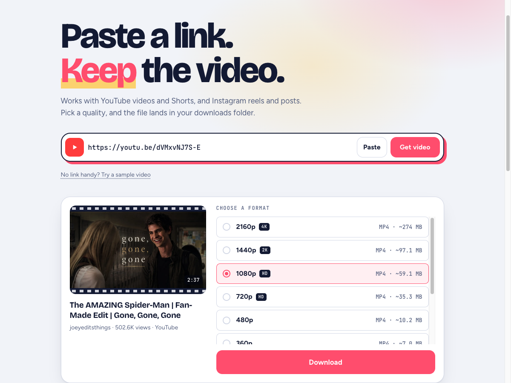
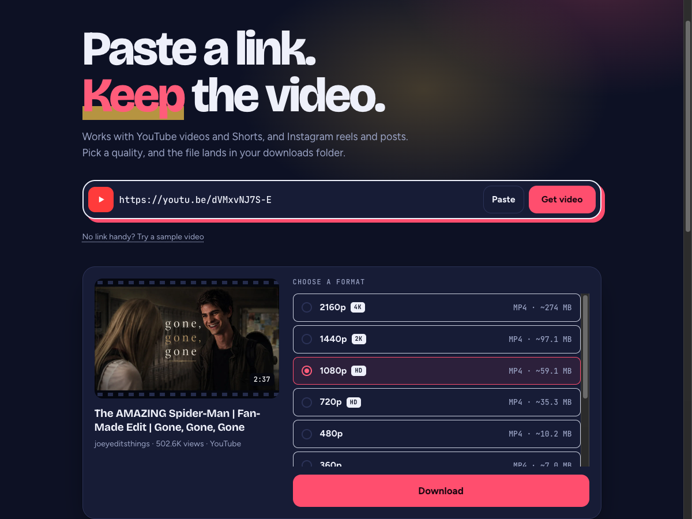
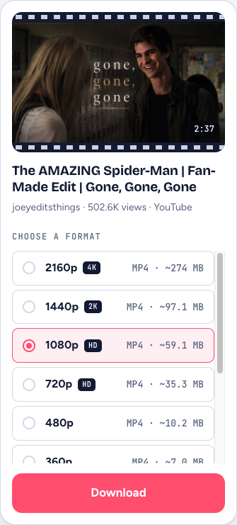

# Clipdrop

Paste a YouTube, Instagram or TikTok link, pick a quality, and save the video as MP4 (up to 4K) or the audio as MP3.

Built by [Pratik Patel](https://github.com/pratik227) · [@PratikPatel_227 on X](https://x.com/PratikPatel_227)



## Screenshots

| Dark theme | Phone |
| --- | --- |
|  |  |

The theme follows your system setting.

## Share menu on Android

Clipdrop is an installable web app. Open it in Chrome on Android, choose **Add to Home screen**, and it appears in the Share menu of YouTube, Instagram and TikTok, so you can send a video straight to it instead of copying the link.

- The site must be served over HTTPS for Chrome to offer the install, so this needs a deployed copy or a tunnel, not `http://localhost` on another device.
- iOS does not let websites join the Share menu. Copy and paste the link there.
- Any link can also be passed directly: `https://your-host/?url=<video link>`.

## Run with Docker

```bash
docker compose up -d --build
```

Open http://localhost:5050. Stop it with `docker compose down`.

Without Compose:

```bash
docker build -t clipdrop .
docker run -d --name clipdrop -p 5050:5050 clipdrop
```

## Run without Docker

Needs Python 3.10+, `ffmpeg` and `node` on your PATH.

```bash
python3 -m venv .venv
.venv/bin/pip install -r requirements.txt
.venv/bin/python app.py
```

## Configuration

| Variable       | Default        | What it does                                            |
| -------------- | -------------- | ------------------------------------------------------- |
| `PORT`         | `5050`         | Port the server listens on                              |
| `HOST`         | `127.0.0.1`    | Bind address when running `app.py` directly             |
| `COOKIES_FILE` | `./cookies.txt`| Netscape-format cookies for login-gated posts           |

### Instagram posts that need a login

Instagram hides many posts from logged-out visitors. Export your browser cookies to `cookies.txt` (Netscape format), then either place it next to `app.py`, or uncomment the `environment` and `volumes` lines in `docker-compose.yml`.

## Deploying

Any host that runs a container works: Render, Railway, Fly.io, or a VPS. Point it at the `Dockerfile`; the server reads the `PORT` variable the host provides.

- Keep it to **one instance**. Download jobs and progress are held in memory.
- YouTube often blocks data-centre IP addresses, so downloads that work at home can fail in the cloud.
- TikTok is unreachable in countries where it is banned. The server has to run somewhere that can reach it.
- There is no rate limiting or login. Add them before sharing a public URL.
- If downloads start failing, rebuild to pick up the newest yt-dlp: `docker compose build --no-cache`.

## How it works

- `app.py`: Flask API. `/api/info` reads the video details, `/api/download` starts a job, `/api/progress/<id>` reports progress, `/api/file/<id>` sends the file.
- `static/index.html`: the whole frontend in one file.
- [yt-dlp](https://github.com/yt-dlp/yt-dlp) does the extraction; ffmpeg merges streams and converts audio.

## Fair use

Only download videos you own or have permission to save. Respect creators' rights and each platform's terms of service.
